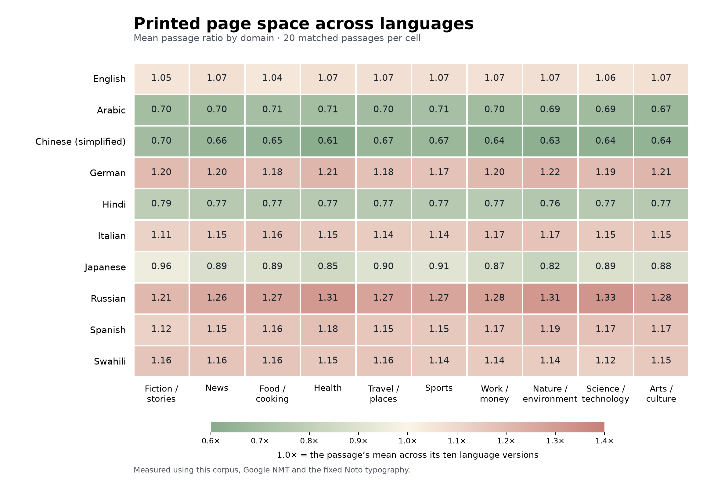

# LangPrint Bench

How much space does the same message occupy on a printed page across languages?

The dataset contains **200 original passages and 1,800 translations** across
ten languages and ten domains. All 2,000 versions have occupied-page scores.

## Static interface

Open [index.html](index.html) directly in a browser, keeping `renderer.js` beside
it. The site is static HTML/CSS/JavaScript, with no server, build step or external
requests. Use edge arrows, left/right keys or a horizontal edge drag on desktop.
Home and Contents icons stay at the top left on desktop and mobile.
On mobile, every generated page appears in one continuous vertical scroll.

About is stored as one continuous text. The book and `score.py` both call
[`renderer.js`](renderer.js) for the same prose styles and automatic pagination.
It fills each page up to 21 lines when text remains, then continues onto the next.
Reference pages are scaled on smaller screens without changing line breaks.
Title and heatmap pages retain their dedicated layouts.

Page 1 is the title and page 2 the heatmap; visible page numbers begin at 3.
The contents begin on page 5, follow the heatmap’s discipline order, and list
English display translations of all 200 titles, grouped under discipline
headings with indented entries and starting page numbers. Original corpus titles
are unchanged. Each text reserves `2 * ceil(max(occupied_pages) / 2)` pages
using all ten language versions. The 200 English texts follow the complete contents spread. Unused pages in each
text’s allocation remain blank and numbered, including on mobile. Click a contents
entry to open its first page. Left pages carry the text title; right pages carry
the discipline. An asterisk beside a title marks a passage originally written
in English, in both Contents and the running title. Reserved blank pages keep
their running header and page number. Contents entries flow into the
same fixed page area, keeping a discipline heading with its first title.

The 100 cells are a snapshot of [data/heatmap.json](data/heatmap.json), using the
same ordered axes, ratios and shared 0.6–1.4 scale. Keep the embedded table in
sync when updating the exported results. The font licence is in `assets/fonts/OFL.txt`. Small embedded Noto subsets preserve
the scorer’s fonts for redaction bars, circled digits and π in the English texts.

## Occupied-page score

```sh
python3 -m venv .venv
source .venv/bin/activate
pip install -r requirements.txt
python -m playwright install chromium
```

```python
from score import score

occupied_pages = score(entry)  # entry is a decoded JSON object
```

Only `lang` and `text` affect the result. The scorer uses the fixed layout in
section 3 of [methodology.md](methodology.md). Exact Noto font files are downloaded
on first use and cached in `.cache/fonts/`; a language can be scored offline once
its fonts are cached. Noto Sans Mono supplies missing symbols such as redaction
bars; the pinned Noto Serif JP font is the final fallback for enclosed digits
such as ①②③④. Passage text stays local. Run checks with
`python -m unittest -v test_score test_renderer`.

## Translation

`translate.py` uses Google Cloud Translation Basic v2 with `model=nmt`, plain
text and explicit source/target languages. It needs only Python's standard
library. It reads `GOOGLE_TRANSLATE_API_KEY` if set, otherwise the macOS Keychain
item with service `langprint-bench.google-translate` and your login account.

```sh
# Inspect the first-passage pilot without reading credentials or calling Google.
python3 translate.py --idx 1 --dry-run

# Translate that original into the other nine languages.
python3 translate.py --idx 1

# Inspect the remaining corpus cost, then run it when ready.
python3 translate.py --all --dry-run
python3 translate.py --all
```

The runner adds translations directly to `data/results.json`, preserving every
original record. A translation keeps the source passage's `idx`, `discipline`,
`title` and `source`; its `lang` is the target language, `text` is the translation
and `original` is `0`. Originals retain `original: 1`;
`(idx, lang)` identifies a unique version. A complete run
contains **200 originals + 1,800 translations = 2,000 records**. Only originals
are sent to Google, so translations are never chained through another language.
Existing original `occupied_pages` measurements are retained; translated versions
are measured separately. Use `--output PATH` to write the combined corpus elsewhere instead.

Each first successful raw response, exact request settings and UTC timestamp
are saved atomically under `data/translation-cache/`, which is ignored by Git.
Keep this local directory with the experiment. A rerun reuses matching cached responses without API calls or
Keychain access; changing the original text or engine settings creates a new
cache key. Successful responses are retained after interruptions, and completed
records are merged into the dataset when a run exits. Reruns do not duplicate
`(idx, lang)` records. The script stops rather than overwrite the corpus if
another process edits it during translation. Returned text is preserved without HTML unescaping or whitespace
normalization. Temporary HTTP 429/5xx and connection failures get at most three
attempts; ambiguous network failures can result in duplicate billable requests.
Run one translation process at a time. Costs printed by dry runs are for uncached
input characters at $20/million, before monthly credits, taxes or currency
conversion. Run offline checks with `python3 -m unittest -v test_translate`.

Translations are retained as returned by the engine, without semantic quality
review or manual corrections. Technical checks cover nonempty responses,
supported languages, complete coverage and record structure.

## Data and heatmap

[`data/results.json`](data/results.json) is ordered by `idx`, with the original
first and its nine translations following. Each record includes:

| Field | Meaning |
| --- | --- |
| `occupied_pages` | Rendered body-text lines divided by 21. |
| `occupied_pages_avg` | Arithmetic mean of `occupied_pages` across the ten versions sharing an `idx`. |
| `occupied_pages_ratio` | `occupied_pages / occupied_pages_avg`. |

Ratios are dimensionless: **1.20 means 20% more page space** than the same
passage's multilingual average; **0.80 means 20% less**. Values are not rounded
in the dataset.

After installing the requirements above, rebuild the heatmap with:

```sh
python heatmap.py
python -m unittest -v test_heatmap
```

This writes [`data/heatmap.json`](data/heatmap.json) and
[`data/heatmap.png`](data/heatmap.png), without modifying the source records.
The JSON contains ordered language/domain axes and 100 cells. Each cell's
`occupied_pages_ratio` is the **arithmetic mean of the 20 passage ratios** for
that language/domain, with `n: 20`. Every passage receives equal weight.
The export also records its metric, aggregation, reference value and source
file hash.

The figure uses one linear diverging colour scale centred at **1.0**. Green
means less space and red means more. These results describe this selected
corpus, Google NMT and the fixed Noto typography.


